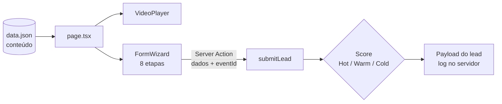

<div align="center">

# Landing Page VSL para Restaurantes

**Protótipo de landing page de alta conversão: VSL, narrativa de venda e formulário de qualificação em 8 etapas com score de lead.**


</div>

---

## Visão geral

Landing page para uma agência vender um pacote de **produção de vídeo + gestão de tráfego pago** a donos de restaurante. O fluxo pensado no [PRD](./prd.md) é: anúncio → VSL de 45–60 s → narrativa de problema e solução → portfólio → formulário de qualificação → revelação do preço apenas após o preenchimento.

> **Status:** protótipo funcional de front-end. Os textos, o número de WhatsApp e os vídeos em `src/content/data.json` são **placeholders**, e o envio do lead ainda não está integrado a um CRM (veja *Limitações*).

## Problema que resolve

Páginas de captação genéricas atraem curiosos. Este projeto explora uma estratégia de **escalada de compromisso**: perguntas fáceis primeiro (Instagram, cidade), perguntas de maior atrito depois (faturamento, orçamento, poder de decisão), e o preço só aparece no final, ancorando o valor antes do número.

## Principais funcionalidades

| Funcionalidade | Onde está |
|---|---|
| **Player de VSL** customizado sobre `<video>` HTML5, com poster e botão de play (sem autoplay) | `src/components/VideoPlayer.tsx` |
| **Formulário em 8 etapas** com barra de progresso, validação por etapa (React Hook Form + Zod) e opções clicáveis | `src/components/FormWizard.tsx` |
| **Revelação de preço** somente após concluir o formulário | `src/components/FormWizard.tsx` |
| **Score de lead** (`Hot` / `Warm` / `Cold`) calculado no servidor a partir de faturamento, orçamento, poder de decisão e disposição para investir em mídia | `src/app/actions/submitLead.ts` |
| **Conteúdo editável** (headline, VSL, benefícios, portfólio) separado do código | `src/content/data.json` |
| **Direção visual** dark com tipografia Inter + Playfair Display | `src/app/layout.tsx`, `src/app/globals.css` |

## Stack

| Camada | Tecnologia |
|---|---|
| Framework | Next.js 16 (App Router, Server Actions) + React 19 |
| Linguagem | TypeScript |
| Estilo | Tailwind CSS 4, `class-variance-authority`, `tailwind-merge`, `lucide-react` |
| Formulários | React Hook Form + Zod |
| Animação | Framer Motion |

## Arquitetura



```text
src/
├── app/
│   ├── actions/submitLead.ts   # Server Action: score + payload do lead
│   ├── layout.tsx · page.tsx · globals.css
├── components/
│   ├── FormWizard.tsx          # formulário multi-etapas
│   ├── VideoPlayer.tsx         # player da VSL
│   └── ui/                     # button, card, input
├── content/data.json           # textos, VSL, benefícios, portfólio
└── lib/utils.ts
prd.md                          # requisitos do produto
```

## Requisitos

- Node.js 20.9 ou superior
- npm

## Como executar localmente

```bash
git clone https://github.com/Gabriel-serra-eng/landing-restaurante-vsl.git
cd landing-restaurante-vsl
npm install
npm run dev
```

Acesse [http://localhost:3000](http://localhost:3000). Nenhuma variável de ambiente é necessária para rodar o protótipo.

### Variáveis de ambiente (opcionais, previstas para a integração com Meta)

| Variável | Descrição |
|---|---|
| `NEXT_PUBLIC_META_PIXEL_ID` | ID do Pixel da Meta |
| `META_CAPI_TOKEN` | Token da Conversions API — apenas servidor, nunca expor ao cliente |

Veja [`.env.example`](./.env.example). Hoje essas variáveis só são referenciadas em um bloco comentado em `submitLead.ts`; a integração não está ativa.

## Testes e validações

- Verificação de tipos (`tsc --noEmit`) passa sem erros.
- **Ainda não há testes automatizados.**

## Limitações

- O envio do lead **só registra o payload no log do servidor** (CRM em modo *mock*); não há persistência nem notificação.
- O disparo de eventos (Pixel, `dataLayer`, marcos de 25/50/75/100% da VSL) está descrito no PRD, mas ainda marcado como comentário no código.
- A tipagem do payload da Server Action usa `any` e deve ser substituída por um tipo inferido do schema Zod.

## Próximas melhorias

Itens previstos no PRD e ainda pendentes:

- [ ] Integrar o envio do lead a um CRM/webhook e à Meta Conversions API
- [ ] Eventos de rastreamento da VSL (0/25/50/75/100%)
- [ ] Substituir os conteúdos placeholder por vídeos, portfólio e provas reais
- [ ] Seção de prova social (depoimentos) — prevista no PRD, ainda sem implementação

## Processo de desenvolvimento com IA

Protótipo construído com desenvolvimento assistido por IA. **A aplicação não chama modelos de IA em tempo de execução.**

| Etapa | Ferramenta | Artefato |
|---|---|---|
| 1. Estratégia de funil e escopo | Definidos antes do código | [`prd.md`](./prd.md) |
| 2. Implementação | Desenvolvimento assistido por IA | `src/` |
| 3. Direção visual | Preparado para iteração no Claude Design | Histórico de commits |
| 4. Apoio de design ao agente | Skills de design de terceiros | `.agents/skills/` |

### Responsabilidades

- **Minhas:** estratégia de escalada de compromisso, perguntas do formulário, critérios do score de lead (faturamento, orçamento, poder de decisão, disposição para mídia).
- **Com assistência de IA:** escrita dos componentes, da validação e da Server Action.
- **De terceiros:** as skills em `.agents/skills/` (design, brand, slides, ui-styling e outras) são pacotes externos usados pelo agente; não são de minha autoria.

## Autor

**Gabriel Serra** — [GitHub](https://github.com/Gabriel-serra-eng)
